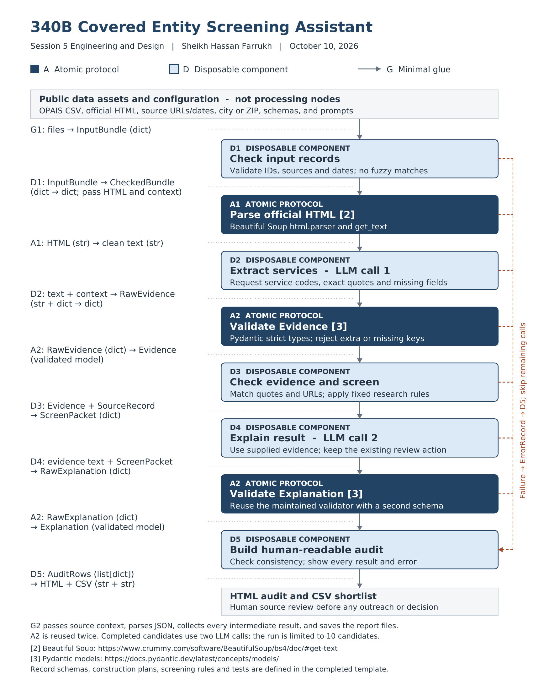

# 340B Covered Entity Screening Assistant

This project supports source-linked research on up to 10 New York health-center candidates using user-selected HRSA OPAIS records and saved service pages from official organization websites. Human review is required before any action. This repository currently contains the Session 6 unit tests for A1 Parse HTML; it does not implement the complete screening workflow.

## Wire diagram

A1 Parse HTML converts saved official HTML to text after D1 checks the input records and before D2 extracts service evidence in the planned screening workflow.



## Protocol input and output

A1 uses Beautiful Soup through this exact interface:

```python
BeautifulSoup(html, "html.parser").get_text(" ", strip=True)
```

- Input: saved HTML as a Python `str`.
- Output: extracted text as a Python `str`, which may be empty.
- The parser is the Python standard library `html.parser`; text nodes are joined with one space and surrounding whitespace is stripped.

`test_parse_html.py` and `requirements.txt` are unchanged from the Session 6 submission. All test inputs are invented. The tests make no network requests or LLM calls and require no API key.

## Setup and tests

Use Python 3.12.14, the version used for the Session 6 submission.

```sh
python -m venv .venv
```

Activate the environment in Windows PowerShell:

```powershell
.\.venv\Scripts\Activate.ps1
```

Or activate it on macOS/Linux:

```sh
source .venv/bin/activate
```

Install the pinned dependencies and run the tests:

```sh
python -m pip install -r requirements.txt
pytest -v
```

The suite contains 19 test cases covering ordinary HTML, nested text, whitespace, entities, excluded script/style/template/comment content, empty inputs, plain text, malformed HTML, Unicode, a long page, JavaScript-only content, retained navigation, and invalid input types.

## Known limitations

Beautiful Soup does not execute JavaScript, so a page whose service content is loaded only by JavaScript can produce empty text. Navigation is retained and must be reviewed. Parsing text does not verify the accuracy or completeness of website claims, link a website to an OPAIS record, or establish 340B eligibility or contracting willingness. Exception behavior and other observed details are checked against the pinned package versions.

In the planned workflow, saved official HTML is linked manually to a separate registry record and checked before parsing. One human-supplied correction may pass through input validation and parsing again; unresolved or missing evidence remains marked `verify`. The full workflow includes additional components that are not implemented by this test suite.

