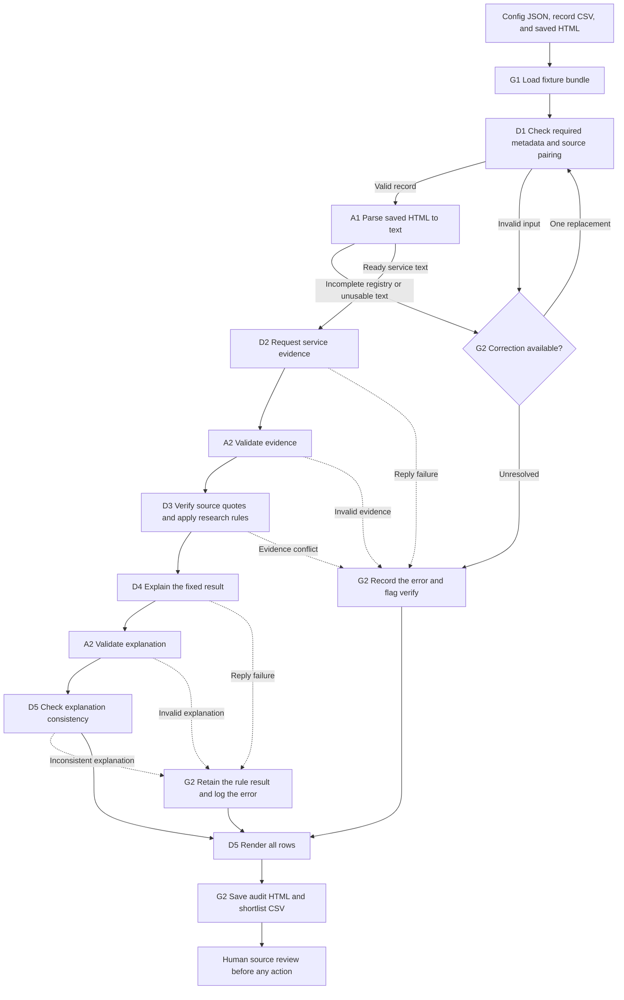

# Session 11 workflow wire diagram

`A` = atomic protocol, `D` = disposable component, `G` = glue. The model steps use synthetic replies by default; an optional local backend uses the same boundaries.

Bundle format errors stop before candidate processing. A missing or unreadable saved page can use the same one-replacement path. An invalid model reply never supplies new evidence or changes the rule result.
